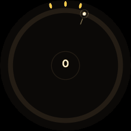

# Golden Angle

An endless, crown-controlled sunflower game for Wear OS, built for Pixel Watch 4 and 5 and priced at 69p.



Sunflowers place each new seed 137.5° round from the last: the **golden angle**, the one angle that packs seeds perfectly. In this game you're the sunflower.

- **Turn the crown** to aim. A seed buds on every beat.
- **Miss the red shadows** cast by your most recent seeds.
- **Hit the gold spot**, one golden angle on, for a Fibonacci multiplier: ×2, ×3, ×5, ×8, ×13, ×21. You feel a haptic click as you enter the gold zone.
- **Three petals** are your lives. Each bloom (5, 13, 34, 55, 89… seeds) speeds the tempo, adds shadows and gives a petal back.

Play well and you draw a perfect Vogel sunflower. Play badly and your flower shows it.

## Docs

- [docs/research.md](docs/research.md): store survey, Wear OS market gaps, puzzle shortlist, why this concept
- [docs/playtest.md](docs/playtest.md): three rounds of playtesting and tuning, with numbers and frames
- [store/](store): Play listing, pricing notes, privacy policy, icon, feature graphic, screenshots

## Project layout

| Module | What it is | Needs Android SDK? |
|---|---|---|
| `core/` | The whole game: rules, tuning, scene description. Pure Kotlin, unit tested. | No |
| `app/` | The Wear OS app: Compose canvas, crown and touch input, haptics, ambient mode, saved scores. | Yes |
| `tools/` | Bot playtest simulator, screenshot and GIF renderer, Play Store art. | No |

The watch and the screenshot tool draw from the same `SceneBuilder` output, so the screenshots match what the watch shows.

`settings.gradle.kts` only includes `:app` when it finds an Android SDK (`ANDROID_HOME`, or `sdk.dir` in `local.properties`). On a machine without an SDK, `core` and `tools` still build and test.

## Build

```sh
./gradlew :core:test                 # unit tests
./gradlew :app:assembleDebug         # app/build/outputs/apk/debug/app-debug.apk
./gradlew :app:bundleRelease         # app/build/outputs/bundle/release/app-release.aab (unsigned)

./gradlew :tools:installDist
./tools/build/install/tools/bin/tools sim 400       # bot playtest table
./tools/build/install/tools/bin/tools diag 400      # bruise rate per bloom
./tools/build/install/tools/bin/tools shots out 456 # screenshots of real bot play
./tools/build/install/tools/bin/tools gif out.gif 260 30
./tools/build/install/tools/bin/tools store store/art
```

The **"Golden Angle (Wear OS game)"** GitHub Actions workflow runs all of this on every push that touches `golden-angle/`. Download `golden-angle-builds` from the run page for the APK and AAB.

## Put it on your Pixel Watch

1. On the watch: **Settings › System › About › Versions**, then tap **Build number** 7 times to enable developer options.
2. **Settings › Developer options**: turn on **ADB debugging** and **Wireless debugging**, then tap **Pair new device** to get an IP, port and pairing code.
3. On your computer (needs Android platform-tools):
   ```sh
   adb pair <ip>:<pairing-port>      # enter the pairing code
   adb connect <ip>:<port>
   adb install app-debug.apk
   ```
4. Turn the crown on the start screen to check it feels right. Tap **Crown speed** at the bottom of the start screen to switch between slow, medium and fast. If none of them feels right, change `CrownSpeed` in `app/src/main/kotlin/uk/co/philsn/goldenangle/Prefs.kt`.

## Sign and upload to Google Play

1. Create an upload key once, and keep it somewhere safe (it's git-ignored):
   ```sh
   keytool -genkeypair -v -keystore upload.jks -alias upload -keyalg RSA -keysize 2048 -validity 10000
   ```
2. Create `keystore.properties` next to this README (git-ignored):
   ```properties
   storeFile=upload.jks
   storePassword=…
   keyAlias=upload
   keyPassword=…
   ```
   Or set `GOLDEN_ANGLE_STOREFILE`, `GOLDEN_ANGLE_STOREPASSWORD`, `GOLDEN_ANGLE_KEYALIAS` and `GOLDEN_ANGLE_KEYPASSWORD` in the environment.
3. Run `./gradlew :app:bundleRelease`. The AAB is now signed with your upload key. Opt in to **Play App Signing** when you upload it.
4. In the Play Console:
   1. Create the app as a **Game**, **Paid**.
   2. Under **Advanced settings › Form factors**, add **Wear OS**.
   3. Upload the AAB to a **closed testing** track first. New personal accounts need 12 testers for 14 days before production.
   4. Fill in the store listing from `store/listing.md`, with graphics from `store/art/`.
   5. Content rating: IARC questionnaire. Data safety: "no data collected" (see `store/privacy-policy.md`).
   6. Set the price to £0.69 (see `store/pricing.md`).
5. Before each update, bump `versionCode` and `versionName` in `app/build.gradle.kts`.

## Move it to its own repository

The game currently lives in the `golden-angle/` folder of the `philsn` repo, because this session couldn't create a new repository. To give it its own repo with full history:

```sh
# In a clone of philsn, on the branch that has golden-angle/:
git subtree split --prefix=golden-angle -b golden-angle-only
# Create an empty repo on GitHub called golden-angle, then:
git push git@github.com:psherwinnicholls/golden-angle.git golden-angle-only:main
```

Then move `.github/workflows/golden-angle.yml` into the new repo. Drop the `working-directory: golden-angle` default and the `golden-angle/` prefix on the artifact paths.

## Tuning

Every difficulty number lives in `core/src/main/kotlin/uk/co/philsn/goldenangle/core/Tuning.kt`. After changing one, run `tools sim` and `tools diag` to see the effect. The playtest log explains why each value is what it is.
