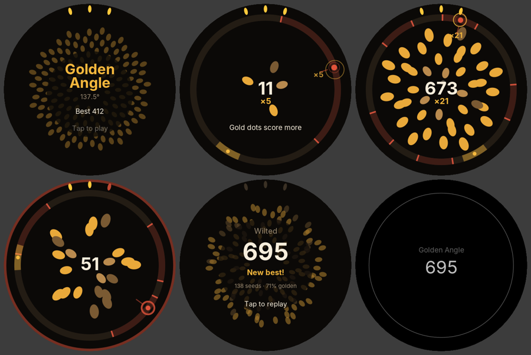
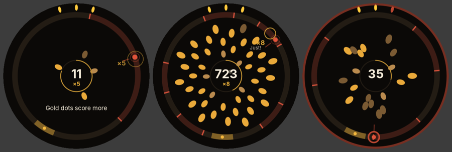
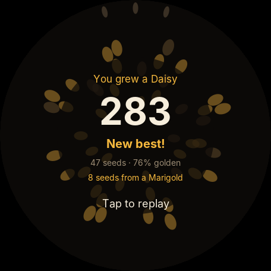

# Playtest log

I can't put a Pixel Watch on a wrist from a cloud container, so each round uses three sources of evidence:

1. **Bot playtests.** `tools sim` plays 400 games for each of four skill models (novice, casual, skilled, expert). Each model is a person turning a crown: a reaction delay, Fitts'-law movement time, a top crown speed, aiming noise that grows with distance, and the odd lapse. The numbers are estimates, not measurements. They are good for comparing one tuning with another and bad for predicting exact real-world scores.
2. **Rendered frames.** `tools shots` draws real bot games through the same scene code the watch uses, at Pixel Watch resolution, so I can judge readability and look.
3. **A design critique against what makes short games addictive:** clear failure that feels fair, instant restart, a visible skill ceiling, near misses, and a reason for "one more go".

The targets for a 69p watch game played in a queue or between sets:

| Measure | Target |
|---|---|
| Novice median run | 30–60s: long enough to learn something, short enough to retry |
| Expert median run | 3+ minutes, so it is really endless and has a long skill ceiling |
| Skill spread | Experts should last 4–6× longer than novices; score spread much wider |
| First bruise | After 15s or more for most players, so the start doesn't feel cheap |
| Deaths caused by being "late" | Under half; most failures should be choices or aim, not impossible tempo |

---

## Round 1: first playable

**Rules.** A seed buds every beat at the crown's aim. It must miss the shadows cast by the last *K* seeds. Landing one golden angle (137.5°) either way from the last seed builds a Fibonacci multiplier: ×2, ×3, ×5, ×8, ×13, ×21. Three petals are your lives. Each "bloom" level (at 5, 13, 34, 55, 89… seeds) raises *K* through 1, 2, 3, 5, 8, 13, shortens the beat by 10% (1.25s down to a 0.42s floor) and heals a petal.

| Skill | Median run | 10th–90th pct | Median score | 90th pct score | Median bloom | Golden rate | Near misses/min | Late bruises | First bruise |
|---|---|---|---|---|---|---|---|---|---|
| novice | 33s | 20–59s | 26 | 52 | 2 | 7% | 3.7 | 88% | 10s |
| casual | 45s | 25–54s | 50 | 77 | 3 | 28% | 1.3 | 82% | 18s |
| skilled | 66s | 55–72s | 314 | 468 | 4 | 69% | 2.4 | 80% | 32s |
| expert | 88s | 65–104s | 791 | 1035 | 4 | 83% | 3.8 | 53% | 42s |

**What's wrong:**

- **The tempo is a wall, not a slope.** 80–88% of bruises happen because the crown physically can't travel 137° before the beat lands. By bloom 4 (0.82s per seed) everyone dies, so the expert lasts only 1.3× as long as the novice. That fails the endless brief and gives good players nowhere to go.
- **Two golden spots ruin the picture.** With gold on both sides, players (and bots) take whichever is nearer, so direction flips and the seeds never form a sunflower spiral. That spiral is the game's best reward and its reason to exist. Frame 3 above shows a scatter instead.
- **Shadows shout.** At bloom 0, a single seed's shadow covers 165° of the ring in bright red. The screen reads as "mostly danger" before you've done anything.
- **The attract screen is hard to read.** "Tap to play" sits on top of busy seeds.
- **Seeds are round blobs.** They should look like seeds.
- **The novice's first bruise comes at 10s.** That's too early: it happens during bloom 1, when the second shadow appears.

**What works:**

- The core loop reads instantly from a single frame: ring, shadows, a gold dot, your bud.
- Near misses happen 2–4 times a minute, which is a healthy "phew" rate.
- The score spread between skill levels is already wide (26 vs 791). The multiplier works as a skill ceiling.

---

## Round 2: one golden direction, a gold "detent", a tempo that bends rather than breaks

**Changes:**

1. **One golden spot, always clockwise.** Steady golden play now draws a true Vogel sunflower, the visual reward the whole game is built around.
2. **The gold zone snaps.** A bud within ±10° of the gold spot is planted exactly on it. On the watch this is paired with a haptic click as you enter the zone, so the crown feels like it has a detent at 137.5°. Gold is now always safe. Before this change, chasing gold was *riskier* than playing safe, and a novice bot that ignored gold outlived the casual bot that chased it. That's the wrong lesson to teach.
3. **The tempo is asymptotic.** Beat = 0.35s + 0.95s × 0.88^bloom. It keeps tightening forever but never hits a floor, and the Fibonacci bloom thresholds mean each faster level lasts longer.
4. **Memory caps at 8 seeds and shadows are narrower** (45% of the golden clearance, down from 60%). With 13-seed memory the safe band shrank to ±5°, a precision wall that no tempo tuning could fix.
5. **"Just!" near misses.** Reaching gold in the final 0.12s of a beat counts as a near miss, which brings back the "phew" moments the snap removed.
6. **Visuals.** Teardrop seeds pointing outwards. Seeds grow in a ring around the flower's eye, where the score now sits, so the score no longer hides the newest seeds. Shadows are dark umber with bright red edges instead of a solid red slab. The attract screen has a dark backing behind its text.

**Simulator fixes.** I also corrected two flaws in my own bot model. Without these I'd have been tuning against a worse-than-human player:

- Bots now make **corrective sub-movements** after their first crown flick, as people do.
- Fitts' law now uses the **real width of the landing zone** (20° for gold) rather than a fixed 4°.
- I added a **"rhythm" bot** that knows where gold will be and turns steadily without reacting. It tests whether spinning at a constant speed breaks the game. It doesn't: it does slightly *worse* than the reactive skilled bot, because constant speed can't recover after a mistake.

| Skill | Median run | 10th–90th pct | Median score | 90th pct score | Median bloom | Golden rate | Near misses/min | Late bruises | First bruise |
|---|---|---|---|---|---|---|---|---|---|
| novice | 103s | 60–134s | 109 | 146 | 5 | 13% | 4.5 | 76% | 25s |
| casual | 115s | 62–150s | 220 | 327 | 5 | 45% | 10.2 | 56% | 40s |
| skilled | 131s | 95–187s | 951 | 1405 | 5 | 77% | 4.9 | 4% | 58s |
| expert | 193s | 139–271s | 3382 | 4820 | 6 | 95% | 2.7 | 0% | 106s |
| rhythm | 122s | 82–172s | 814 | 1266 | 5 | 78% | 1.0 | 0% | 49s |

Bruises per seed at each bloom:

| Bloom | Beat | Memory | Shadow ±° | Gold clearance ° | novice | casual | skilled | expert |
|---|---|---|---|---|---|---|---|---|
| 0 | 1.30s | 1 | 61.9 | 75.6 | 3.6% | 2.0% | 1.1% | 0.5% |
| 1 | 1.19s | 2 | 38.2 | 46.7 | 3.2% | 2.0% | 0.8% | 0.4% |
| 2 | 1.09s | 3 | 23.6 | 28.9 | 3.5% | 2.4% | 0.6% | 0.1% |
| 3 | 1.00s | 5 | 14.6 | 17.9 | 5.1% | 4.4% | 2.5% | 0.2% |
| 4 | 0.92s | 5 | 14.6 | 17.9 | 5.6% | 4.1% | 2.8% | 0.3% |
| 5 | 0.85s | 8 | 9.0 | 11.0 | 8.4% | 8.3% | 5.1% | 2.1% |
| 6 | 0.79s | 8 | 9.0 | 11.0 | 4.6% | 12.7% | 5.3% | 3.3% |

**Better:**

- **Score spread is now 31×** (109 to 3,382) and runs line up with skill. A watch game's leaderboard number has a long ceiling.
- **The first bruise comes at 25s for novices** (was 10s), so the opening feels fair.
- **Late arrivals are no longer the main killer for skilled players** (4%, was 80%).
- Golden play now visibly draws a sunflower. Frame 3 is a ×21 streak.

**Still wrong:**

- **Bloom 5 is a wall.** Memory jumps from 5 to 8 seeds and the safe band narrows from 18° to 11° in one step, so casual bruise rates double (4% to 8–13%). Walls feel unfair; slopes feel like "I nearly had it".
- **The opening is slow.** A 1.3s beat with one shadow gives a novice about 25s of nothing much happening. On a watch, the first 10 seconds sell the second game.
- **Survival times are still only about 2× apart from novice to expert,** because every bot has some lapse rate (looking away from the watch) that kills at a steady background rate. This is probably realistic. Score is where skill shows, which is the right place.
- **There's no reason to come back tomorrow,** and nothing on the game-over screen says "you were close to something".

---

## Round 3: smooth the slope, quicken the start, give a reason for one more go

**Changes:**

1. **No more bloom-5 wall.** Memory now grows 1 → 2 → 3 → 5 → 5 → 6 → 7 and stops. Going from 5 to 6 to 7 seeds adds shadows without narrowing the gold band (6 and 7 steps back are never closer than 5). Long-run difficulty comes from the tempo alone, which players read as "I need to be quicker", not "that was unfair".
2. **Quicker opening.** The first beat is 1.15s (was 1.3s). Beat = 0.35s + 0.8s × 0.88^bloom.
3. **Rarer, more special "Just!".** The just-in-time window is 0.06s (was 0.12s). In the first round-3 run, the faster tempo pushed near misses to 14–19 a minute, so often they meant nothing.
4. **A bloom progress ring** fills round the flower's eye as you approach the next bloom.
5. **Names for what you grew:** Seedling, Sprout, Bud, Daisy, Marigold, Aster, Zinnia, Sunflower, Giant Sunflower, Golden Sunflower. The game-over screen says "You grew a Daisy". When you were within 8 seeds of the next bloom, it adds **"3 seeds from a Marigold"** in gold. The start screen shows your best flower under your best score.
6. **The score scales down** to fit inside the eye at 4+ digits.

| Skill | Median run | 10th–90th pct | Median score | 90th pct score | Median bloom | Golden rate | Near misses/min | Late bruises | First bruise |
|---|---|---|---|---|---|---|---|---|---|
| novice | 88s | 41–180s | 97 | 218 | 4 | 6% | 2.7 | 85% | 18s |
| casual | 80s | 58–102s | 157 | 229 | 4 | 41% | 7.6 | 77% | 32s |
| skilled | 127s | 81–204s | 898 | 1520 | 5 | 73% | 6.7 | 36% | 49s |
| expert | 277s | 160–497s | 4851 | 9278 | 7 | 91% | 4.2 | 11% | 96s |
| rhythm | 125s | 76–190s | 1026 | 1846 | 5 | 78% | 1.1 | 6% | 46s |

| Bloom | Beat | Memory | Shadow ±° | Gold clearance ° | novice | casual | skilled | expert |
|---|---|---|---|---|---|---|---|---|
| 0 | 1.15s | 1 | 61.9 | 75.6 | 3.3% | 2.2% | 1.2% | 0.5% |
| 1 | 1.05s | 2 | 38.2 | 46.7 | 4.1% | 1.8% | 0.9% | 0.3% |
| 2 | 0.97s | 3 | 23.6 | 28.9 | 4.9% | 2.4% | 1.1% | 0.2% |
| 3 | 0.90s | 5 | 14.6 | 17.9 | 6.0% | 4.4% | 2.9% | 0.3% |
| 4 | 0.83s | 5 | 14.6 | 17.9 | 4.7% | 8.2% | 3.2% | 0.9% |
| 5 | 0.77s | 6 | 14.6 | 17.9 | 4.6% | 14.0% | 3.7% | 1.5% |
| 6 | 0.72s | 7 | 14.6 | 17.9 | 4.2% | – | 3.9% | 1.4% |
| 7 | 0.68s | 7 | 14.6 | 17.9 | 9.4% | – | 6.9% | 1.4% |

**Against the targets:**

| Measure | Target | Round 1 | Round 3 |
|---|---|---|---|
| Novice median run | 30–60s | 33s ✓ | 88s ✗ (long, see below) |
| Expert median run | 3+ min | 88s ✗ | 277s ✓ (90th pct 8 min) |
| Skill spread, survival | 4–6× | 2.7× | 3.1× (closer) |
| Skill spread, score | wide | 30× | 50× ✓ |
| First bruise | ≥15s | 10s ✗ | 18s+ ✓ |
| Deaths from impossible tempo | under half | 53–88% ✗ | 11–36% for skilled and expert ✓; casual and novice still mostly late, by choice (see below) |

**Honest verdict on playability and addictiveness:**

- **The hook is strong.** "Hit gold" is learnable in one beat. The haptic detent makes hitting it *feel* good. Steady golden play draws a sunflower that's genuinely pretty, and the game-over screen shows you the flower *you* made. Few watch games give you something to look at when you lose.
- **The "one more go" loop is in place:** sub-two-minute rounds, a tap to replay, a Fibonacci multiplier that rewards streaks steeply (one ×21 seed is worth 21 safe seeds), "3 seeds from a Marigold", and a named best flower to beat.
- **Novices outlast casual players, but score less.** Novices ignore gold and plant safely; casual players chase gold and are sometimes late. That's a fair risk-for-reward choice, and the score (97 vs 157) rewards the braver player. I've left it.
- **Novice runs (about 90s) are longer than the 30–60s target.** On a watch that's acceptable, since there's no waiting about and something new happens every bloom. If real players find the opening dull, set `intervalSpan` to 0.7 so the first beat is about 1.05s.
- **The biggest unknown is the crown itself.** All of this assumes a crown turn of about 137° on screen is a comfortable flick. Pixel Watch crowns report rotation in pixels that I couldn't measure from here. The start screen has a *Crown speed: slow / medium / fast* toggle (tap the bottom of the screen), and `CrownSpeed.MEDIUM` in `Prefs.kt` is the number to tune once it's on a wrist.
- **The bot models are invented.** Crown reaction times, Fitts constants and noise are reasonable guesses, not measurements. The *trends* between rounds are trustworthy; the exact seconds are not. Ten minutes of real play on a Pixel Watch will tell you more than another round of simulation.

**What I'd test first on a real watch:**

1. Crown speed. Can you turn 137° in under a second without overshooting? Try all three settings.
2. Whether the haptic tick on entering gold reads as a "detent" or just noise.
3. Whether "Miss the red shadows" is understood without the hint (watch a friend play once without explaining it).
4. Whether the screen stays awake during a round, and the game pauses when you lower your wrist.
