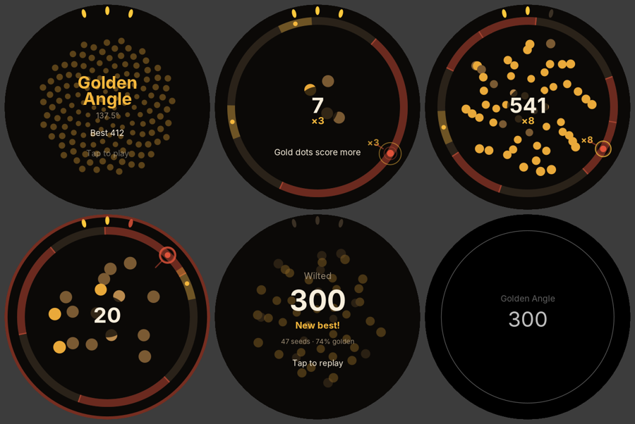

# Playtest log

I can't put a Pixel Watch on a wrist from a cloud container, so each round uses three sources of evidence:

1. **Bot playtests.** `tools sim` plays 400 games for each of four skill models (novice, casual, skilled, expert). Each model is a person turning a crown: a reaction delay, Fitts'-law movement time, a top crown speed, aiming noise that grows with distance, and the odd lapse. The numbers are estimates, not measurements. They are good for comparing one tuning with another and bad for predicting exact real-world scores.
2. **Rendered frames.** `tools shots` draws real bot games through the same scene code the watch uses, at Pixel Watch resolution, so I can judge readability and look.
3. **A design critique against what makes short games addictive:** clear failure that feels fair, instant restart, a visible skill ceiling, near misses, and a reason for "one more go".

The targets for a 69p watch game played in a queue or between sets:

| Measure | Target |
|---|---|
| Novice median run | 30–60s: long enough to learn something, short enough to retry |
| Expert median run | 3+ minutes, so it is really endless and has a long skill ceiling |
| Skill spread | Experts should last 4–6× longer than novices; score spread much wider |
| First bruise | After 15s or more for most players, so the start doesn't feel cheap |
| Deaths caused by being "late" | Under half; most failures should be choices or aim, not impossible tempo |

---

## Round 1: first playable

**Rules.** A seed buds every beat at the crown's aim. It must miss the shadows cast by the last *K* seeds. Landing one golden angle (137.5°) either way from the last seed builds a Fibonacci multiplier: ×2, ×3, ×5, ×8, ×13, ×21. Three petals are your lives. Each "bloom" level (at 5, 13, 34, 55, 89… seeds) raises *K* through 1, 2, 3, 5, 8, 13, shortens the beat by 10% (1.25s down to a 0.42s floor) and heals a petal.

| Skill | Median run | 10th–90th pct | Median score | 90th pct score | Median bloom | Golden rate | Near misses/min | Late bruises | First bruise |
|---|---|---|---|---|---|---|---|---|---|
| novice | 33s | 20–59s | 26 | 52 | 2 | 7% | 3.7 | 88% | 10s |
| casual | 45s | 25–54s | 50 | 77 | 3 | 28% | 1.3 | 82% | 18s |
| skilled | 66s | 55–72s | 314 | 468 | 4 | 69% | 2.4 | 80% | 32s |
| expert | 88s | 65–104s | 791 | 1035 | 4 | 83% | 3.8 | 53% | 42s |

**What's wrong:**

- **The tempo is a wall, not a slope.** 80–88% of bruises happen because the crown physically can't travel 137° before the beat lands. By bloom 4 (0.82s per seed) everyone dies, so the expert lasts only 1.3× as long as the novice. That fails the endless brief and gives good players nowhere to go.
- **Two golden spots ruin the picture.** With gold on both sides, players (and bots) take whichever is nearer, so direction flips and the seeds never form a sunflower spiral. That spiral is the game's best reward and its reason to exist. Frame 3 above shows a scatter instead.
- **Shadows shout.** At bloom 0, a single seed's shadow covers 165° of the ring in bright red. The screen reads as "mostly danger" before you've done anything.
- **The attract screen is hard to read.** "Tap to play" sits on top of busy seeds.
- **Seeds are round blobs.** They should look like seeds.
- **The novice's first bruise comes at 10s.** That's too early: it happens during bloom 1, when the second shadow appears.

**What works:**

- The core loop reads instantly from a single frame: ring, shadows, a gold dot, your bud.
- Near misses happen 2–4 times a minute, which is a healthy "phew" rate.
- The score spread between skill levels is already wide (26 vs 791). The multiplier works as a skill ceiling.
